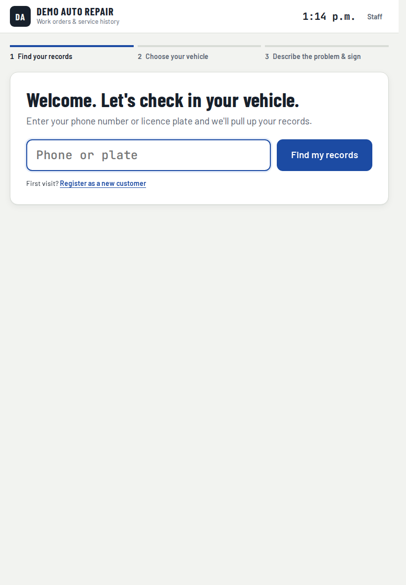
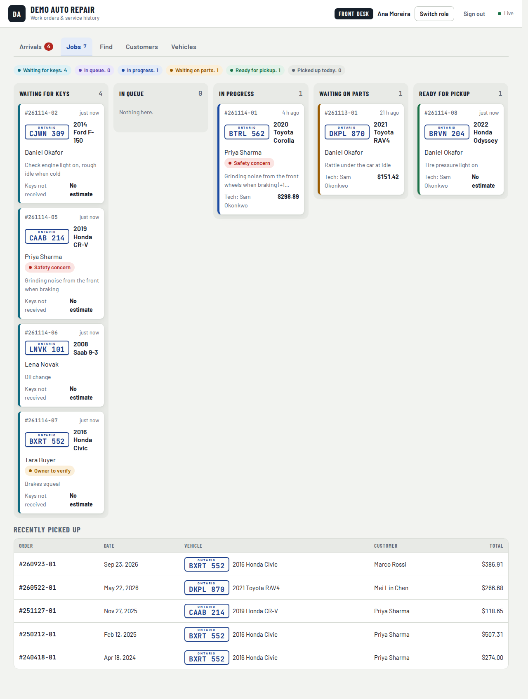
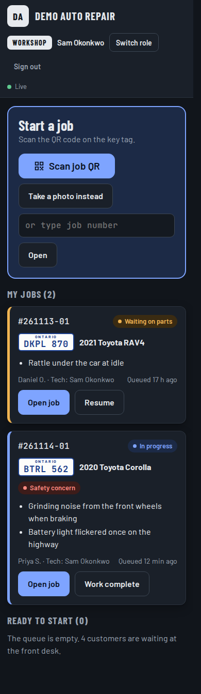
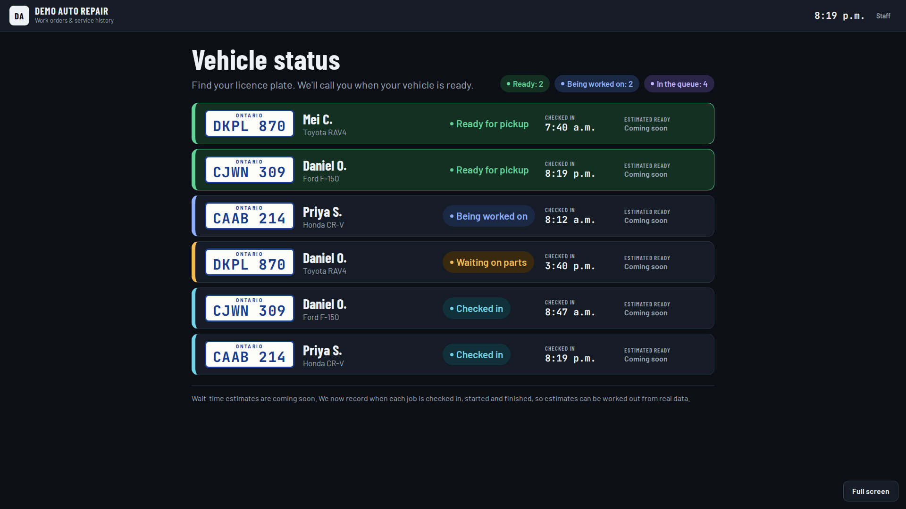

# Workshop Check-In

Open-source shop-floor software for an independent auto repair shop. Customers check themselves in at a kiosk,
the front desk sees jobs arrive live, technicians pick up work by scanning a QR job tag, and a TV in the waiting room
shows where each car is.

| Screen | What it does |
|---|---|
| **Kiosk** | Customers find themselves by phone or plate (or register), pick a vehicle, describe the problem by typing or voice, and sign. AI turns their words into tidy concerns. |
| **Front desk** | Live list of arrivals and active jobs, customers, vehicles and history, work orders with parts, labour and tax, printable QR tags, customer texts. |
| **Workshop** | A technician's queue on a phone or tablet: scan a tag, start work, add notes and items, and mark the job ready. |
| **Display** | Waiting-room board with masked names, live status, full screen. |
| **Administrator** | Staff and roles, PINs, shop settings (tax and labour rate), reports. |

<p>
  
  
  
  
</p>

Built with React + Vite, Supabase (Postgres with row-level security, Realtime, Storage), and AWS (Cognito with Google
sign-in, Lambda, API Gateway, S3 + CloudFront) using Terraform. AI intake uses the Anthropic Messages API.

> **Status:** a working proof of value for one shop in Ontario, Canada. The defaults (Canadian dollars, HST,
> `America/Toronto`, AWS `ca-central-1`, English) reflect that. The data model is multi-shop ready.

---

## Quick start (local, about 5 minutes)

You can run the whole app on your own computer with demo data. You don't need any cloud accounts or API keys.

### 1. Prerequisites

| Tool | Version | Check |
|---|---|---|
| [Node.js](https://nodejs.org) | 20 or newer | `node -v` |
| [Docker](https://docs.docker.com/get-docker/) (Desktop or Engine) | running | `docker info` |
| Git | any | `git --version` |

The local database runs in Docker through the Supabase CLI, which `npm` installs for you. Make sure ports
**54321–54324, 5173, 8787 and 8788** are free.

### 2. Clone, set up, run

```bash
git clone https://github.com/desmond80in/AutoMoto.git
cd AutoMoto
npm run setup      # checks Node + Docker, installs dependencies, creates frontend/public/config.json
npm run dev        # starts Supabase (with demo data), dev sign-in, mock AI intake and the app
```

The first `npm run dev` downloads the Supabase Docker images, which takes a few minutes. Later starts take seconds.

### 3. Open the app

Go to **http://localhost:5173** and pick a demo account (no password in dev mode):

| Account | Roles | PIN |
|---|---|---|
| `owner@example.com` | all (administrator, front desk, workshop, kiosk, display) | 4321 |
| `ana.desk@example.com` | front desk, kiosk, display | 2222 |
| `sam.tech@example.com` | workshop | 1111 |

Choose a role on the role picker. The kiosk and display screens ask for a PIN to unlock or exit.

Things to try:

- **Kiosk:** search for plate `BRVN204` (or phone `647 555 0198`) and check in Daniel's Odyssey.
- **Front desk:** watch the new arrival appear without refreshing, open the job, and print its QR tag.
- **Workshop:** sign in as Sam, start the job, and mark it ready.
- **Display:** open it in a second browser window and watch the board update.

The AI intake runs against a **mock** server locally, so you don't need an Anthropic key. Texts to customers are recorded
as *simulated* and never sent.

### Everyday commands (from the repo root)

| Command | What |
|---|---|
| `npm run dev` | Start everything (resets the database to the demo data) |
| `npm --prefix frontend run dev:stack -- --no-reset` | Start without resetting the data |
| `npm run reset` | Reset the local database to the demo data |
| `npm run stop` | Stop the Supabase Docker containers |
| `npm test` | Unit tests (backend Lambdas + frontend) |
| `npm run test:db` | Database tests (pgTAP; Supabase must be running) |
| `npm run check` | Lint + typecheck, backend and frontend |
| `npm run e2e` | Playwright end-to-end tests (run `npm run setup -- --e2e` once to install the browser) |

Local Supabase Studio (a database browser) is at http://localhost:54323.

### Troubleshooting

- **`Docker is installed but not running`**: start Docker Desktop, or run `sudo systemctl start docker`, then try again.
- **Port already in use**: stop the other process, or run `npm run stop` if an old Supabase stack is still up.
- **Sign-in page lists no accounts or shows an error**: the dev token server (:8787) didn't start. Check the
  terminal output of `npm run dev`. Dev sign-in only works against the local Supabase on purpose.
- **Blank page**: check that `frontend/public/config.json` exists. Running `npm run setup` again recreates it from
  `config.example.json`.

---

## Deploy for a real shop

A hosted deployment needs these accounts:

| Service | For | Cost (approx.) |
|---|---|---|
| [Supabase](https://supabase.com) | Database, realtime, file storage | Free for a demo. Pro (US$25/month) for real customer data, because Free has no backups |
| [AWS](https://aws.amazon.com) | Sign-in (Cognito), AI and SMS API (Lambda), web hosting (S3 + CloudFront) | A few dollars a month for one shop |
| [Google Cloud](https://console.cloud.google.com) | OAuth client for "Sign in with Google" | Free |
| [Anthropic](https://console.anthropic.com) | AI intake (Claude) | Pay per use, cents per day for one shop |
| AWS End User Messaging SMS *(optional)* | Customer texts | Per message + phone number |

Tools: Terraform ≥ 1.7 and the AWS CLI, in addition to the local prerequisites.

The full step-by-step runbook is in **[`infra/README.md`](infra/README.md)**. In short:

1. Create a Supabase project and fill `backend/.env` from [`backend/.env.example`](backend/.env.example).
2. Build the Lambdas (`cd backend && npm run build:lambdas`), then `terraform apply` in `infra/` (copy
   `terraform.tfvars.example` first).
3. Create a Google OAuth client using the redirect URI that Terraform prints, store the secrets with
   `npx tsx scripts/put-secrets.ts`, and apply again.
4. Turn on Supabase third-party auth for the Cognito user pool, then push the migrations
   (`npx supabase db push --remote`).
5. Create the first owner and shop (`npx tsx scripts/bootstrap-owner.ts`).
6. Write the frontend config and deploy (`npm run deploy` in `frontend/`), then run the smoke test.

Each shop is one deployment. Secrets live in AWS SSM Parameter Store, never in git.

**Before you use it with real customers:** replace the demo authorization wording on the kiosk with your shop's
legal text, use Supabase Pro (backups), and sign in the kiosk/TV with a dedicated staff account that only has the
kiosk and display roles (see "Known PoV limitation" in [`backend/README.md`](backend/README.md)).

---

## How it works

```
Browser (React SPA) ──► CloudFront ──► S3 (static app + /config.json)
   │  Sign in with Google ──► Cognito ──(pre-token Lambda adds staff_id, shop_id, roles)
   │  supabase-js + Cognito token ──► Supabase: RLS-protected reads, RPC writes, Realtime
   └─ HTTPS + JWT ──► API Gateway ──► Lambdas: AI intake (Anthropic), customer texts (SMS)
```

- **All business rules are in Postgres** (`backend/supabase/migrations`) as `security definer` functions. Clients
  read through row-level security and write only through RPCs.
- The kiosk never receives full names, full phone numbers, emails or service history.
- The SPA reads every environment-specific setting from `/config.json` at start-up, so one build runs anywhere.

## Repository layout

| Folder | What | Read |
|---|---|---|
| [`docs/`](docs) | Specifications, decisions log, approved clickable prototype | `SPEC-BACKEND.md`, `SPEC-FRONTEND.md`, `DECISIONS.md` |
| [`backend/`](backend) | Supabase migrations, seed and pgTAP tests, Lambdas, ops scripts | [`backend/README.md`](backend/README.md) |
| [`frontend/`](frontend) | React 18 + Vite SPA, Vitest and Playwright tests | [`frontend/README.md`](frontend/README.md) |
| [`infra/`](infra) | Terraform for AWS | [`infra/README.md`](infra/README.md) |
| [`scripts/`](scripts) | Repo-level setup script | |

Note: the backend spec describes the AWS infrastructure with CDK. This repo uses Terraform instead, and SSM Parameter
Store instead of Secrets Manager. Everything else matches the spec.

## Contributing

Issues and pull requests are welcome. Before you open a PR:

```bash
npm run check && npm test && npm run test:db && npm run e2e
```

- Names in the specs (tables, RPCs, error codes, config keys) are contracts. Keep them as they are.
- Record any choice the specs leave open as one line in [`docs/DECISIONS.md`](docs/DECISIONS.md).
- Database changes go in a new migration file with a pgTAP test. Never edit an applied migration.
- Never commit secrets, `.env`, `terraform.tfvars`, Terraform state or `infra/outputs.json`.
- [`CLAUDE.md`](CLAUDE.md) holds the project rules for AI coding assistants. Human contributors can follow it too.

Please report security issues privately to the maintainer instead of opening a public issue.

## Licence

[MIT](LICENSE) © 2026 Desmond Fernando
